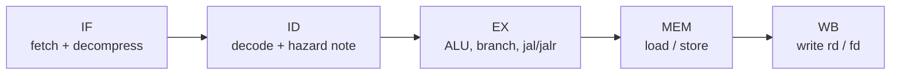
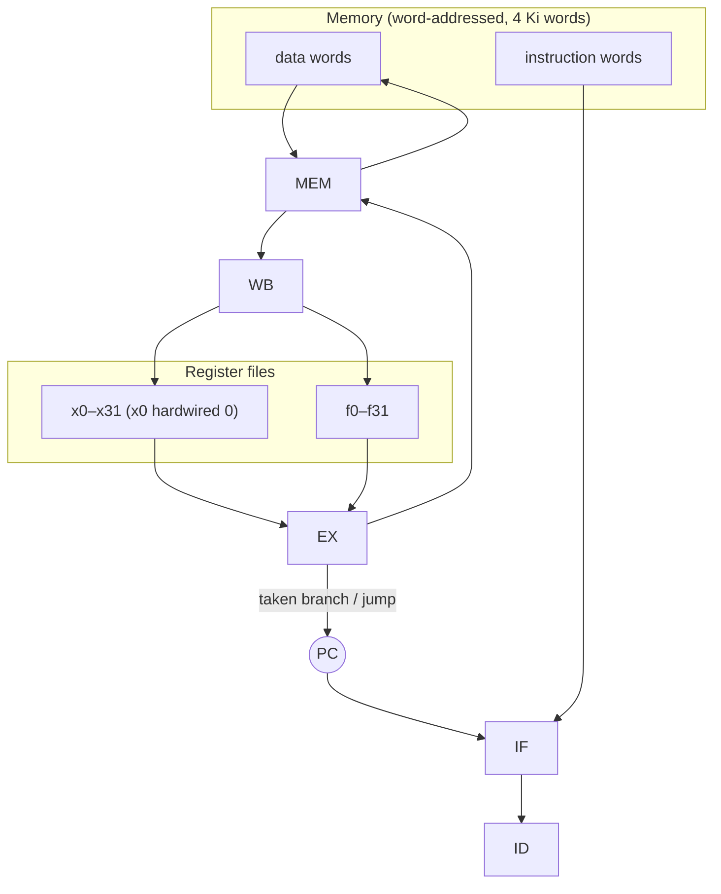
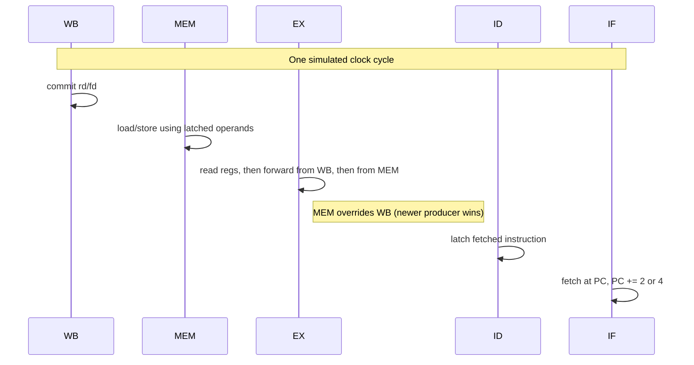
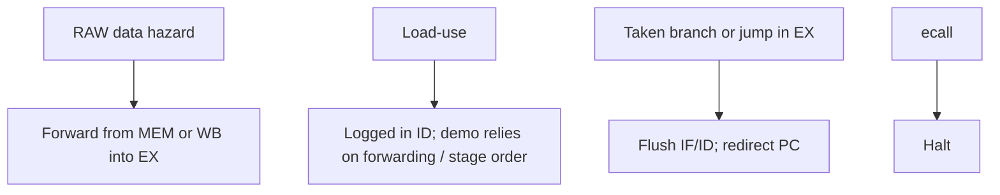

# RISC-V Pipeline Simulator

A cycle-accurate **5-stage RISC-V pipeline** written in C++. It decodes machine code, steps IF → ID → EX → MEM → WB, and prints each stage every cycle so you can watch hazards, forwarding, stalls, and control-flow flushes.

ISA coverage: **RV32I** (base integer), a **subset of the C (compressed) extension**, and a **partial F (single-precision float)** set.

The runnable source is `simulator.cpp`. It is the merge of the original simulator (`Final.cpp`) with the v2 bug fixes (`riscv_final_v2.cpp`).

---

## How the pipeline works

Stages run **backwards each cycle** (WB, then MEM, then EX, then ID, then IF). That matches a hardware clock edge: the oldest instruction writes the register file first, so younger instructions in EX can forward from MEM/WB in the same cycle.





### Cycle order and forwarding



---

## What v2 fixed (now in `simulator.cpp`)

| Issue in v1 | Fix |
| --- | --- |
| Branch / `jal` / `jalr` used the **fetch PC**, often off by 4 | Each stage keeps its own PC; targets and link addresses use **EX PC** (`PC+imm`, link = `PC+4`) |
| Forwarding applied MEM then WB, so **older WB overwrote newer MEM** | Apply **WB first, then MEM** |
| Byte/halfword access ignored the byte offset | Shift by `(addr % 4) * 8`; stores merge with a mask |
| Compressed bit check used the **whole word** | Test the **halfword at `PC % 4`** |
| Halfword accesses had no alignment rule | Require **2-byte** alignment for halfword load/store |
| ALU/FP writeback was incomplete | One `compute_integer_result` / `compute_float_result` path for execute + writeback |

v1 also inserted a **load-use stall**. v2 treats that as a log line only: reverse stage order plus forwarding is enough for the bundled demo. A true interlocked pipeline would still stall a load whose result is needed in the next instruction’s EX before MEM completes.

---

## Instruction support

### RV32I

| Format | Instructions |
| --- | --- |
| R | `add`, `sub`, `sll`, `slt`, `sltu`, `xor`, `srl`, `sra`, `or`, `and` |
| I (ALU) | `addi`, `slti`, `sltiu`, `xori`, `ori`, `andi`, `slli`, `srli`, `srai` |
| I (load) | `lb`, `lh`, `lw`, `lbu`, `lhu` (`lwu` / `ld` are decoded; treated as word on this RV32 model) |
| S | `sb`, `sh`, `sw` (`sd` decoded as word) |
| B | `beq`, `bne`, `blt`, `bge`, `bltu`, `bgeu` |
| U | `lui`, `auipc` (decoded; `auipc` is not yet written back) |
| J | `jal`, `jalr` |
| SYSTEM | `ecall` (halts), `ebreak` (decoded) |

### Compressed (C) — implemented

Expanded to 32-bit in IF, then run as the matching RV32I op:

- `c.addi`, `c.lw`, `c.sw`, `c.beqz`

`c.bnez` is listed in older notes but **not** implemented.

### Floating-point (F) — partial

- `fadd.s`, `fsub.s`, `fmul.s`, `fdiv.s`
- `flw`, `fsw`

No rounding-mode, `fmv`, compares, or conversions.

---

## Hazards



- **x0** is forced to 0 after every writeback.
- Misaligned word/halfword accesses halt with a reason string.
- Fetching past the last instruction inserts a **bubble** so `jalr` / `ecall` already in the pipe can finish; the sim stops when the pipeline is empty (or on `ecall`).

---

## Built-in demo program

`main()` loads a small program at `0x1000` (not a random opcode dump):

1. Sum `1 + 2 + 3 + 4 + 5` in a `blt` loop (`x2 = 15`).
2. `sw` the sum at `0x1100`, then `lw` it back into `x6`.
3. `jal` to a subroutine that does `addi x6, x6, 10`, then `jalr` return.
4. Store `25` at `0x1104` and `ecall`.

That path exercises ALU, branch, load/store, `jal`/`jalr`, and halt.

---

## Build and run

Needs a C++17 compiler.

```bash
g++ -std=c++17 simulator.cpp -o riscv_simulator
./riscv_simulator
```

On Windows (MinGW / MSYS):

```powershell
g++ -std=c++17 simulator.cpp -o riscv_simulator.exe
.\riscv_simulator.exe
```

Output is a per-cycle trace: Fetch, Decode, Execute, Memory, Writeback.

To try other machine code, replace the `program` vector in `main()` with 32-bit little-endian RISC-V words (compressed ops packed in the low or high halfword of a word, matching PC).

---

## Project layout

| File | Role |
| --- | --- |
| `simulator.cpp` | **Canonical** decoder + CPU + demo (`main`) |
| `Final.cpp` | v1 snapshot (kept for comparison) |
| `riscv_final_v2.cpp` | v2 snapshot (kept for comparison) |

Compile **`simulator.cpp`** for interviews and demos.

---

## Ideas to extend

- Finish `auipc` writeback (needs the instruction PC in the result helper)
- More C-extension opcodes (`c.bnez`, `c.j`, `c.mv`, `c.li`, …)
- Full RV32F and RV32M
- Real load-use interlock (stall IF/ID one cycle)
- Branch predictor + mispredict stats
- Cache / memory hierarchy
- Cycle counts: IPC, stall/flush tallies
